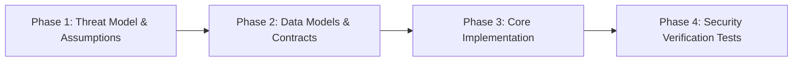

# AI Agent Security Execution Protocol & System Instructions

This document provides system-level guidance and rules of engagement for AI coding assistants (such as Antigravity, Claude Code, GitHub Copilot, Codex, Cursor, etc.) tasked with implementing, refactoring, or auditing security features in this repository.

---

## 1. Prime Directives for AI Agents

When implementing any security feature:
1. **Never Compromise on Invariants:** Security controls (authentication, authorization, encryption, input sanitization) must be enforced server-side. Never rely on client-side controls alone.
2. **Fail Closed & Secure by Default:** 
   - Unauthenticated/unrecognized requests must default to `DENY` / HTTP 401/403/404.
   - Database operations must default to transactional rollback on error.
   - Rate limiters must fail closed or safely throttle if cache services are unreachable.
3. **Zero Secrets in Code or Logs:**
   - Never generate, commit, or log hardcoded API keys, JWT secrets, passwords, or seed phrases.
   - Mask sensitive values in application logs and trace dumps.
4. **Timing-Safe Operations:**
   - Always compare hashes, signatures, tokens, and credentials using constant-time algorithms (e.g. `hmac.compare_digest` in Python, `crypto.timingSafeEqual` in Node.js).
5. **No Blind Trust in Model Output:**
   - Treat AI-generated content, database records, and third-party API payloads as untrusted input. Validate before evaluation or execution.

---

## 2. Standard Implementation Workflow for Agents

When given a prompt from any domain under `security-features-implementation-prompts/`, follow this 4-phase lifecycle:

### Phase 1: Threat Model & Assumptions
Before writing code:
- Identify the trust boundaries (e.g., Client <-> Reverse Proxy <-> API <-> Database).
- Identify threat vectors (e.g., IDOR, timing attacks, replay attacks, SQL injection).
- State explicitly which cryptographic primitives and protocols will be utilized.

### Phase 2: Data Models & Contracts
- Define strict schemas with validation (Pydantic / Zod / Type definitions).
- Disallow unknown fields (`extra="forbid"` or `strict`).
- Annotate required field constraints (regex, min/max length, allowed value ranges).

### Phase 3: Core Implementation
- Implement controllers, services, and repositories following the Single Responsibility Principle.
- Wrap cryptographic functions in defensive wrappers that avoid side-channel leaks.
- Ensure all external inputs are sanitized, escaped, or parameterized.

### Phase 4: Security Verification Tests
Every security implementation must include automated negative tests demonstrating:
- **Tampering Detection:** Modification of 1 byte/bit causes rejection.
- **Bypass Resistance:** Unauthorized roles or cross-tenant IDs are rejected.
- **Replay Resistance:** Timestamps or nonces prevent reused tokens.
- **Side-Channel Mitigation:** Constant-time equality checks are enforced.

---

## 3. Technology Stack Reference Matrix for Agents

| Security Capability | Python Standard | Node.js / TypeScript | Go Standard |
|---|---|---|---|
| **Constant-time comparison** | `hmac.compare_digest(a, b)` | `crypto.timingSafeEqual(bufA, bufB)` | `subtle.ConstantTimeCompare(a, b)` |
| **Password Hashing** | `argon2-cffi` (`Argon2id`) | `argon2` / `@node-rs/argon2` | `golang.org/x/crypto/argon2` |
| **Symmetric Encryption** | `cryptography.fernet` or `AESGCM` | `crypto.createCipheriv('aes-256-gcm', ...)` | `cipher.NewGCM(...)` |
| **CSPRNG (Random bytes)** | `secrets.token_bytes(...)` | `crypto.randomBytes(...)` | `crypto/rand.Read(...)` |
| **Schema Validation** | `pydantic` v2 / `pydantic.Field` | `zod` (`z.object({...}).strict()`) | `go-playground/validator` |
| **HTML Sanitization** | `bleach` / `nh3` | `dompurify` / `sanitize-html` | `bluemonday` |

---

## 4. Prompt Usage Instructions for Users & Operators

To deploy an agent on a specific security feature:
1. Navigate to the relevant subfolder in `security-features-implementation-prompts/`.
2. Copy the entire markdown content from `README.md`.
3. Provide the prompt to your AI coding agent (e.g. Antigravity, Claude Code, Copilot).
4. Supply your target framework/language in the placeholder fields `[LANGUAGE/FRAMEWORK]`, `[DATABASE]`, etc.
5. Instruct the agent: *"Follow the AI Agent Security Execution Protocol in AGENT-GUIDE.md"*.

